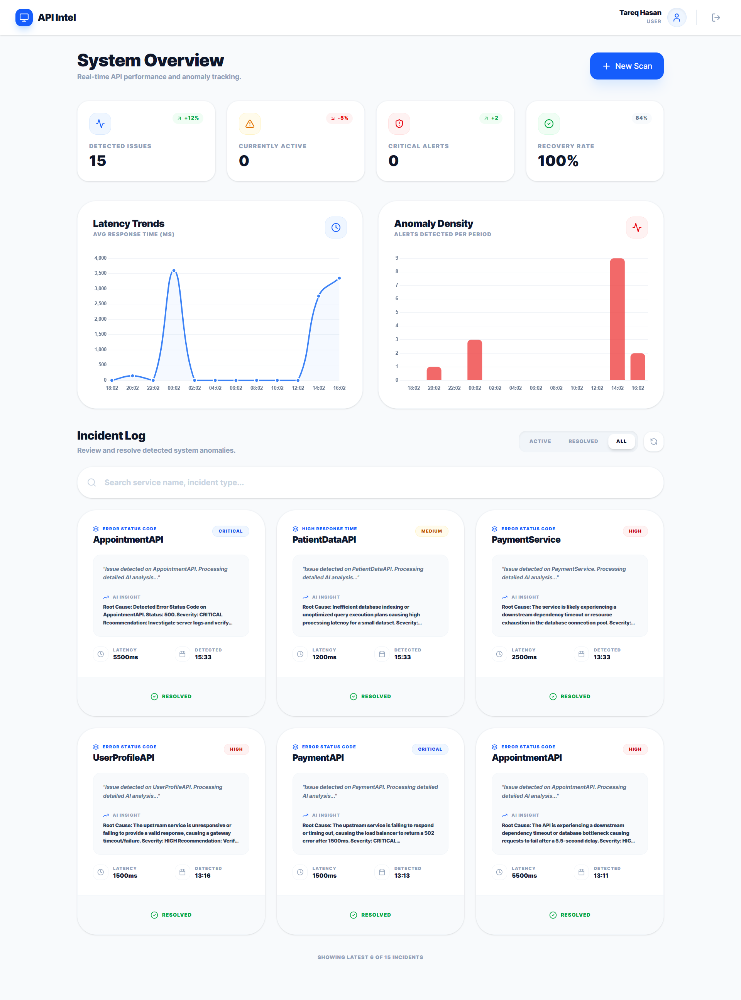

# 🚀 Intelligent API Monitoring Dashboard

A modern, high-performance React dashboard designed for real-time visualization of API anomalies and AI-generated insights. This frontend integrates with a distributed backend to provide actionable SRE (Site Reliability Engineering) alerts.

## ✨ Key Features

  * **Real-time Monitoring:** Instant visualization of incoming API health data.
  * **AI-Powered Insights:** Displays root cause analysis and recommendations generated by Gemini 2.0 Flash.
  * **State Management:** Robust and scalable state handling using **Redux Toolkit (RTK)**.
  * **Performance:** Built with **Vite** for lightning-fast HMR (Hot Module Replacement) and optimized production builds.
  * **Type Safety:** 100% **TypeScript** implementation for reliable and maintainable code.
  * **Responsive UI:** Crafted with **Tailwind CSS** for a clean, professional dark-mode aesthetics.

-----
## Preview

## 🛠️ Tech Stack

  * **Framework:** React 18 (Vite)
  * **Language:** TypeScript
  * **State Management:** Redux Toolkit
  * **Styling:** Tailwind CSS, Lucide React (Icons)
  * **Data Fetching:** Axios / RTK Query
  * **Charts:** Recharts (for anomaly trends)

-----

## 🚦 Getting Started

### Prerequisites

  * **Node.js:** v18.x or higher
  * **npm** or **yarn**
  * **Backend:** Ensure the [Intelligent API Monitor Backend](https://github.com/tareqhasan382/intelligent-api-monitor-backend) is running.

### Installation & Setup

1.  **Clone the repository:**

    ```bash
    git clone https://github.com/tareqhasan382/intelligent-api-monitor-frontend.git
    cd intelligent-api-monitor-frontend
    ```

2.  **Install dependencies:**

    ```bash
    npm install
    ```

3.  **Configure Environment Variables:**
    Create a `.env` file in the root directory:

    ```env
    VITE_API_BASE_URL=http://localhost:5000/api/v1
    ```

4.  **Run the development server:**

    ```bash
    npm run dev
    ```

5.  **Open in Browser:**
    Navigate to `http://localhost:5173` (default Vite port).

-----


-----

## 🔧 Available Scripts

  * `npm run dev`: Starts the development server.
  * `npm run build`: Compiles the application for production.
  * `npm run preview`: Locally previews the production build.
  * `npm run lint`: Checks for linting errors using ESLint.

-----


**Developed by [Tareq Hasan](https://www.google.com/search?q=https://github.com/tareqhasan382)** 🎯